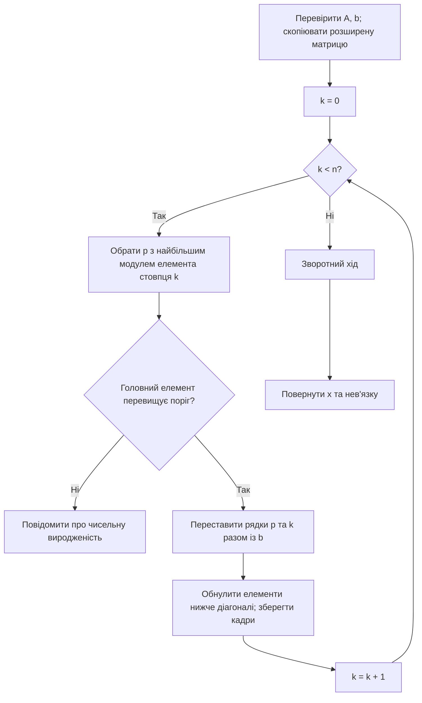
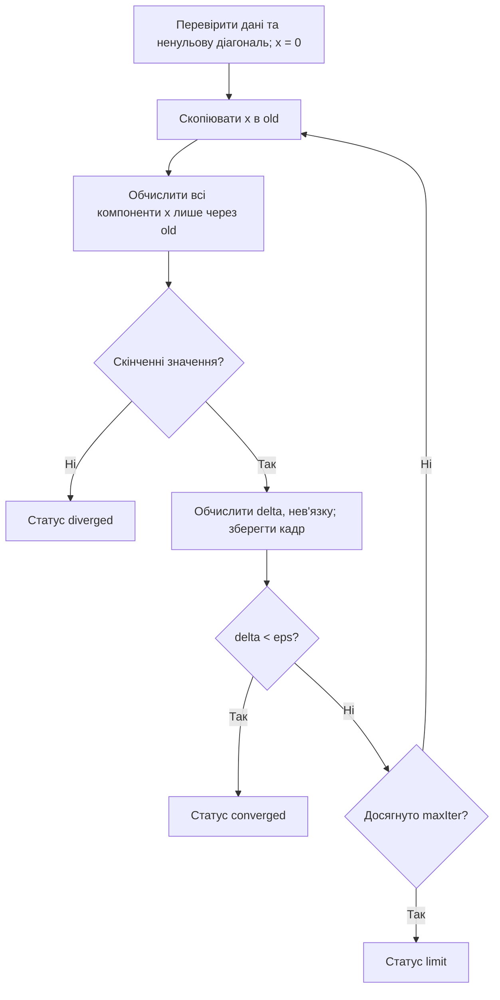
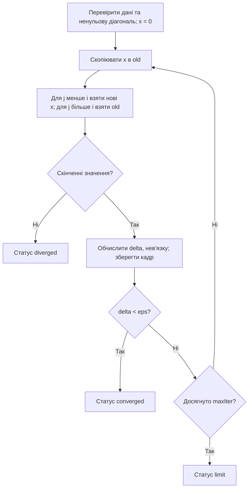
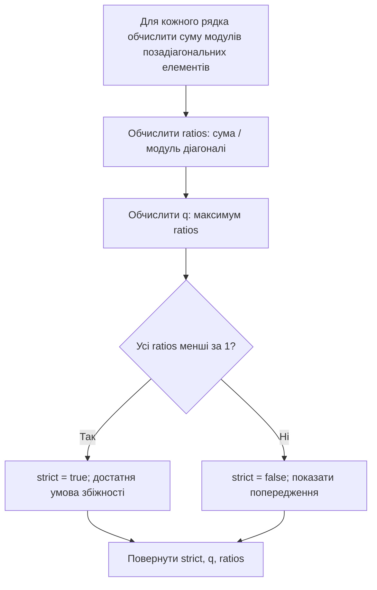
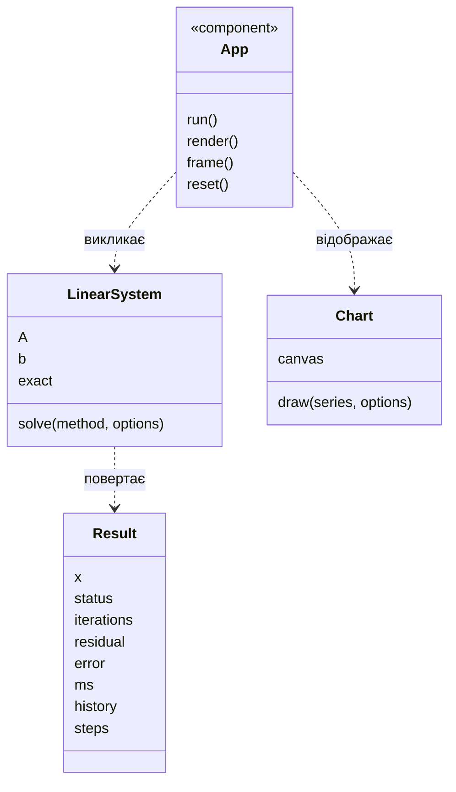
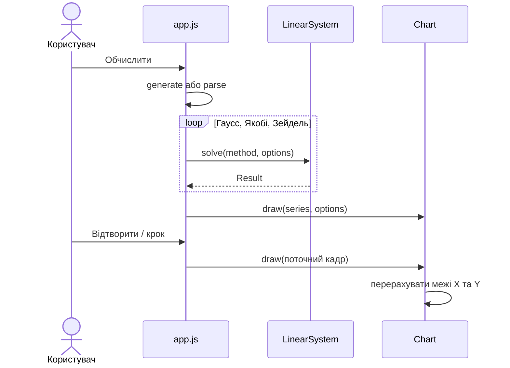

# Схеми лабораторної № 2

Схеми відповідають чисельному ядру `js/math.js` та компонентам інтерфейсу.

## Гаусс

## Якобі

## Зейдель

## Діагональна перевага

## UML класів

App позначає функціональний компонент `app.js`, а не JavaScript-клас.

## UML послідовності

