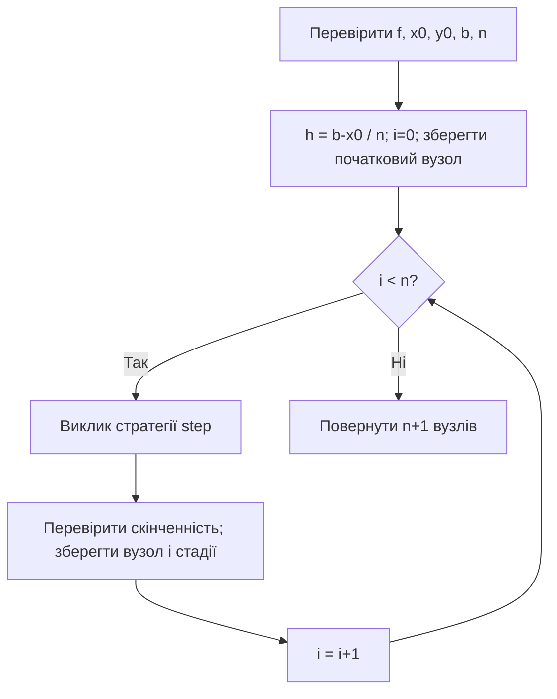
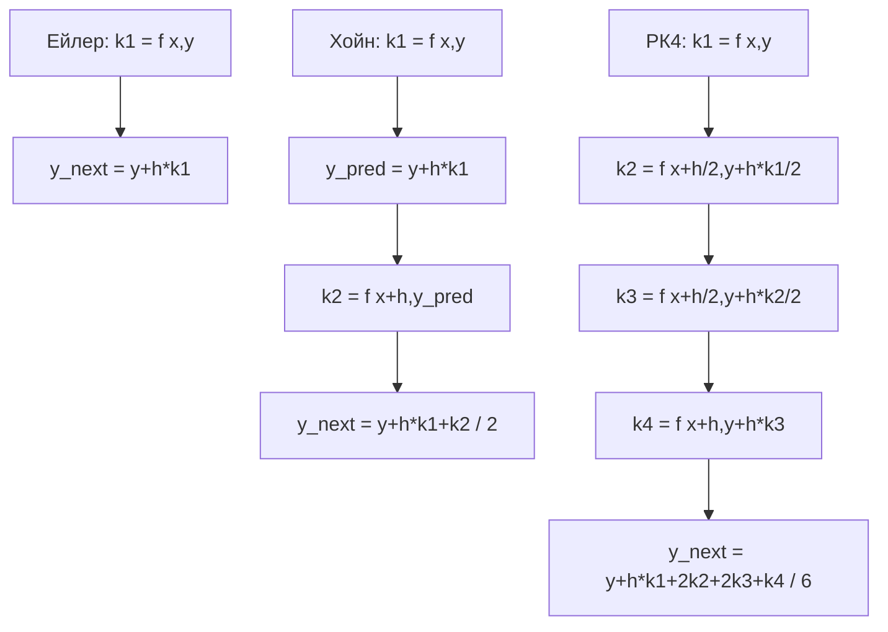

# Алгоритми та ідентифікатори

Варіант 3: y′=y cos x, y(0)=2, x ∈ [0;π].
Для y=2 exp(sin x) похідна y′=2 exp(sin x) cos x збігається з правою частиною; y(0)=2.

## Загальна схема

У блоці обчислення кроку мається на увазі h=(b−x₀)/n.

## Три стратегії

Точні формули підсумку: Хойн — y+h·(k1+k2)/2; РК4 — y+h·(k1+2k2+2k3+k4)/6.

| Ідентифікатор | Призначення |
|---|---|
| f, exact | Права частина та еталон |
| x0, y0, b, n, h | Початкові дані та сітка |
| OdeMethod.step | Контракт одного кроку |
| MethodRegistry | Реєстрація і вибір стратегії |
| CauchySolver.solve | Цикл інтегрування |
| points, stages | Вузли та проміжні оцінки |
| solution.error | Кеш похибок |
| Charts.bounds | Автомасштаб X/Y |
